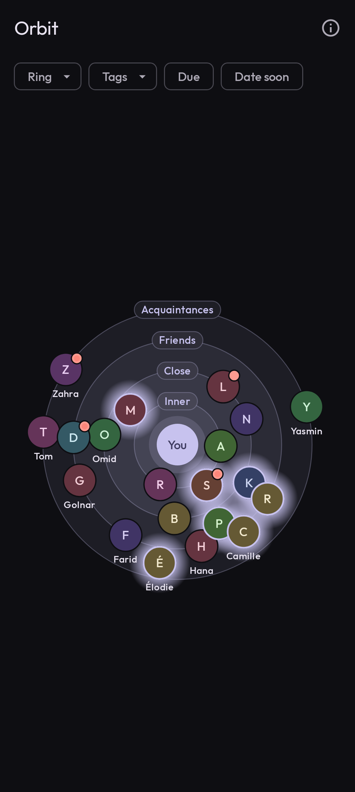
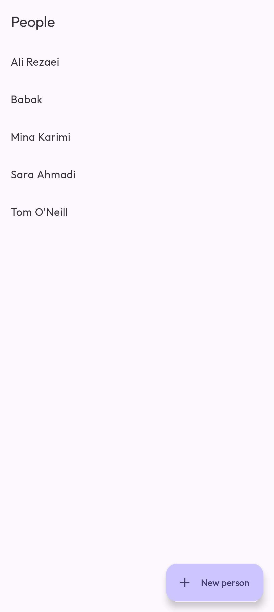
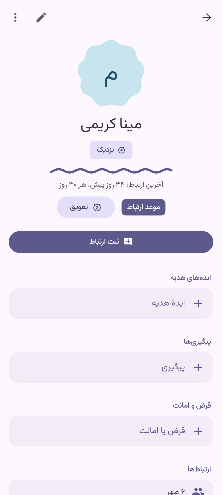
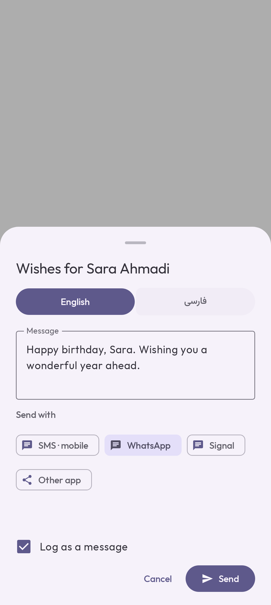

# Orbit

**A personal, offline relationship manager for Android, in English and Persian.**

Orbit remembers the people in your life: their birthdays and other important dates, gift ideas, what they like, what they can help with, and when you last talked. It tells you who you haven't been in touch with for a while. There's no account, no server and no internet permission. Everything stays on your phone.

<p align="center">
  
  
  
  
</p>

## Features

- **People and Rings.** Put each Person in a Ring (Inner, Close, Friends, Acquaintances, or your own) that sets how often you want to be in touch. The Orbit view draws everyone around you, closest in the middle.
- **Keep in touch.** Log calls, messages and meetups. Once it's been longer than a Person's Cadence they're **Due**, until you get in touch or snooze them.
- **Important dates and Occasions.** Birthdays, anniversaries and any date you choose, plus Occasions like Nowruz or Mother's Day for a group of people, each with reminders.
- **Reminders and a home-screen widget.** Notifications on the day or ahead of it, a daily digest of who's Due, and an Upcoming widget.
- **Send wishes.** A ready-made message in English or Persian, sent by SMS, WhatsApp, Telegram, Signal, email or any other app, and logged for you.
- **Gift ideas** for each Person, kept until you mark them as given.
- **Search and filters.** Search names, notes and details, Persian or English, and filter by Ring, Tag, Due or an upcoming date.
- **Three calendars.** Gregorian, Solar Hijri and Lunar Hijri. Each date stays in the calendar it was entered in, so a Persian birthday comes round on the right day every year.
- **Fully bilingual.** English and Persian, right to left, with Persian digits.
- **Private by design.** An optional App lock uses your phone's screen lock. Notifications never show names on the lock screen, and with App lock on they don't show them anywhere.
- **Encrypted backups.** A Backup is a passphrase-protected [age](https://age-encryption.org) file that you save wherever you like. It's how your data survives a lost phone.

## Getting Orbit

Orbit isn't on any app store. You build it from source and install the APK yourself. It needs Android 12 (API 31) or later.

## Building

You need Android Studio's JDK 21 and an Android SDK, with its path in `local.properties`:

```properties
sdk.dir=/path/to/Android/Sdk
```

Then, in Git Bash on Windows (or any shell elsewhere):

```bash
export JAVA_HOME="/c/Program Files/Android/Android Studio/jbr"

./gradlew assembleDebug          # builds app/build/outputs/apk/debug/app-debug.apk
./gradlew installDebug           # installs it on a connected phone or a running emulator
./gradlew testDebugUnitTest lintDebug verifyRoborazziDebug   # unit tests, lint, screenshot tests
```

The debug build is a separate app (`dev.alializadeh.orbit.debug`, with its own icon), so it installs next to the real one without touching its data.

## Release builds

> [!WARNING]
> The release app's identity is permanent ([ADR 0005](docs/adr/0005-orbits-app-identity-is-permanent.md)). Android only installs an update signed with the same key. Lose the key and the only way forward is to uninstall, which deletes everything that isn't in a Backup.

### Once: create the signing key

```bash
scripts/generate-release-keystore.sh   # creates ~/.orbit/orbit-release.jks and keystore.properties
```

Before doing anything else, put the keystore file and the printed password in a password manager, and keep a second offline copy of both. `keystore.properties` and `*.jks` are gitignored. Never commit them.

On a new computer, don't run the script again. Restore the keystore from the password manager and recreate `keystore.properties` instead (the script shows its four lines).

### Each release

1. Raise `versionCode` (and `versionName`) in `app/build.gradle.kts`.
2. Build and install:

   ```bash
   ./gradlew assembleRelease   # app/build/outputs/apk/release/app-release.apk, signed
   adb install -r app/build/outputs/apk/release/app-release.apk
   ```

   `install -r` keeps the app's data. Without `keystore.properties` the release APK is unsigned and won't install.
3. Keep `app/build/outputs/mapping/release/mapping.txt` with the release. It turns the shrunk class names in a shared crash log (Settings → About) back into readable ones, using `retrace` from the Android SDK's command-line tools.

## Tech stack

Kotlin, Jetpack Compose and Material 3 Expressive, Navigation 3, Room, Hilt, Glance for the widget, and [kage](https://github.com/android-password-store/kage) for age encryption. It's a single `:app` module, organised by feature. Tests are JVM unit tests plus Robolectric and Roborazzi screenshot tests, in both languages and in light and dark themes.

## Project docs

- [GLOSSARY.md](GLOSSARY.md): the domain words (Person, Ring, Cadence, Due…) and their Persian UI words.
- [docs/adr/](docs/adr/): the decisions that are hard to reverse, such as [Android only, no sync](docs/adr/0001-android-only-single-device-no-sync.md), [encrypting Backups and not the database](docs/adr/0002-encrypt-backups-not-the-on-device-database.md) and [dates keeping their own calendar](docs/adr/0003-important-dates-keep-their-own-calendar.md).
- [CLAUDE.md](CLAUDE.md): commands, code layout and conventions for working on the code.
